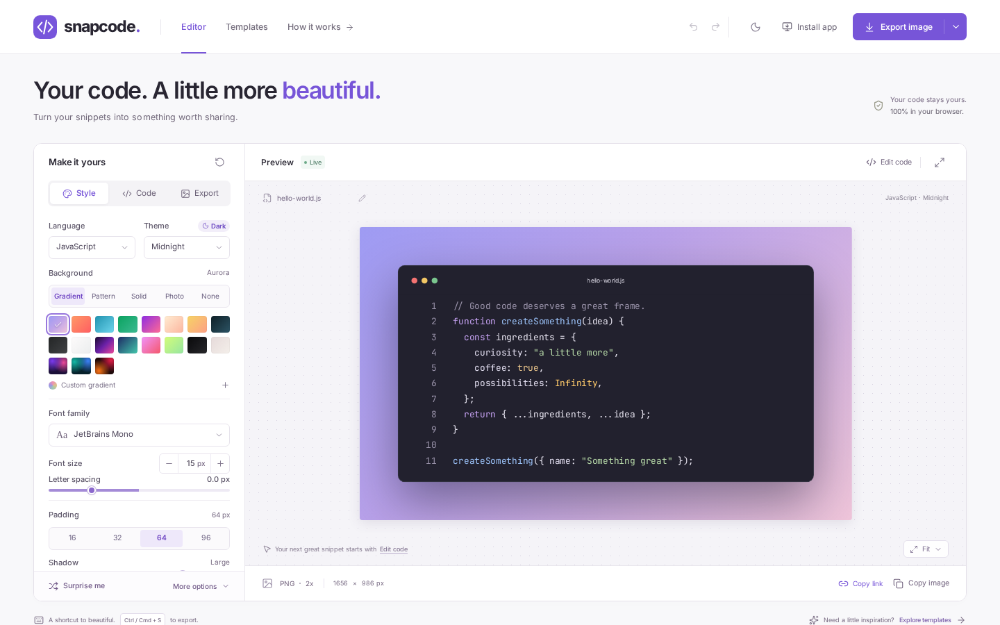
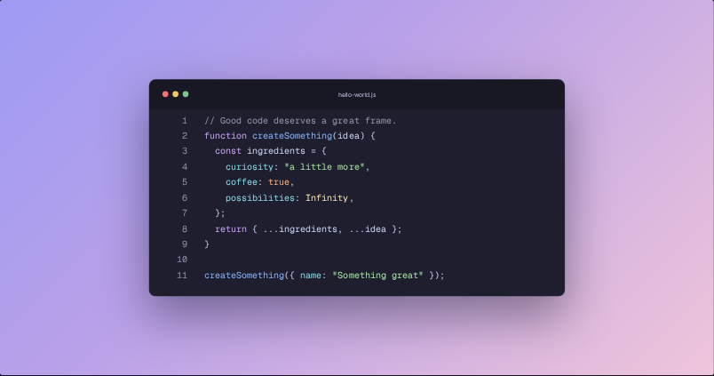
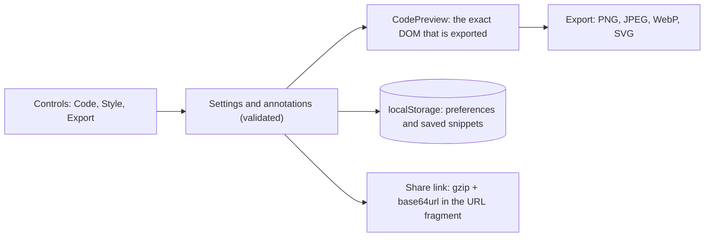

<div align="center">

# Snapcode

**Your code, beautifully framed.**
A private, local-first code-to-image studio. Paste code, style it, and export a crisp PNG, JPEG, WebP, or SVG. Share a link whose code lives only in the URL.

[](docs/WORKFLOW_ACTIVATION.md)
[](docs/workflows/codeql.yml)
[](docs/workflows/scorecard.yml)
[](LICENSE)
[](.nvmrc)



</div>

> **Workflow status:** the app and reviewed workflow templates are on `main`. Live GitHub Actions badges are enabled after the owner pushes `.github/workflows/` with a token that has **Workflows: Read and write**. See [workflow activation](docs/WORKFLOW_ACTIVATION.md). The local verification snapshot is **108 unit tests and 42 desktop/mobile browser runs**.

## Highlights

| Area             | What you get                                                                                                                                                                                                                     |
| ---------------- | -------------------------------------------------------------------------------------------------------------------------------------------------------------------------------------------------------------------------------- |
| **Code**         | 34 languages plus auto-detect. Open, paste, or drop files. Tidy indentation, tab width 2/4/8, wrap long lines, starting line number.                                                                                             |
| **Focus & diff** | Click any line in the preview (`Shift+Click` for range, `Alt+Click` for `+`/`-` diff) or type ranges (`2, 5-7`), choose from 5 highlight accent colours, dim or blur unfocused lines, or show only annotated lines with context. |
| **Style**        | 32 editor themes (23 dark, 9 light), 17 bundled monospace fonts, letter spacing, line height, ligatures, five window styles, four frame borders, window width presets, language badge, custom watermark text, grain texture.     |
| **Backgrounds**  | 18 gradient and mesh backgrounds, 6 geometric patterns, a custom two-colour gradient, solid colour, transparency, and **your own photo** (dimmed, blurred, processed on this device).                                            |
| **Export**       | PNG at 2x, 3x, or 4x; JPEG and WebP with a quality slider; vector **SVG** with fonts embedded.                                                                                                                                   |
| **Frames**       | Auto-fit, Wide 16:9 (1600 × 900), Square 1:1 (1080 × 1080), Portrait 4:5 (1080 × 1350), Social card (1200 × 630), Story 9:16 (1080 × 1920). The code scales to fit inside the frame.                                             |
| **Sharing**      | Copy image, Web Share where supported, and **share links** that keep the code inside the URL fragment (`#s=…`).                                                                                                                  |
| **Library**      | Save up to 30 snippets in this browser, load or delete them, and delete all local data in one step.                                                                                                                              |
| **Platform**     | Installable PWA with offline export, responsive from 320 px, dark studio mode, keyboard shortcuts, and WCAG AA checks in the browser test suite.                                                                                 |



## Quick start

Use Node.js 22 LTS (see `.nvmrc`). Node 20.19 or newer also works.

```bash
npm ci
npm run dev        # http://localhost:5173
npm run build      # icons, bundle, CSP hashes, offline cache version, asset checks
npm run preview    # serve the production build (service worker and offline mode)
```

End-to-end tests run against the production build:

```bash
npx playwright install --with-deps chromium
npm run test:e2e
```

## Scripts

| Command                    | Purpose                                                                           |
| -------------------------- | --------------------------------------------------------------------------------- |
| `npm run dev`              | Development server with hot reload                                                |
| `npm run build`            | Production build with hashed CSP and asset verification                           |
| `npm run preview`          | Serve the production build locally                                                |
| `npm test`                 | Unit tests (Vitest): highlighting, rows, share links, library, settings, contrast |
| `npm run test:e2e`         | Browser tests on desktop and mobile Chromium (Playwright and axe)                 |
| `npm run check`            | Format check, typecheck, lint, unit tests, and build                              |
| `npm run audit:prod`       | Production dependency audit at high severity and above                            |
| `npm run docs:screenshots` | Regenerate the README screenshots from the production build                       |

## Architecture



Read [docs/ARCHITECTURE.md](docs/ARCHITECTURE.md) for module boundaries and [docs/THREAT_MODEL.md](docs/THREAT_MODEL.md) for the security analysis.

## Security and privacy

- **No uploads, accounts, or analytics.** Code is processed in the browser. The app makes no third-party requests at runtime. An offline test asserts this.
- **Fonts are bundled.** Exports work offline and never fetch a remote stylesheet.
- **Share links are not stored on a server.** They hold the snippet in the URL fragment, which browsers do not send to servers. The app limits links to 60 KB and decompressed payloads to 400 KB. **Anyone who has a share link can read the code**, so share links only with people you trust.
- **Saved snippets are explicit.** Nothing is saved unless you click Save. Snippets and preferences stay in this browser and can be deleted at any time.
- **Photos are processed on-device.** They are decoded, downscaled, and re-encoded as JPEG, which removes EXIF metadata such as GPS location.
- **Strict Content Security Policy.** Production scripts are allowed by SHA-256 hash only. `connect-src` is `'self' blob:`, which the photo export needs.
- **Untrusted input is validated.** Settings, share links, library entries, and style JSON are sanitized against allow-lists and bounds. Pasted code is HTML-escaped before highlighting.

Report vulnerabilities privately as described in [SECURITY.md](SECURITY.md). A machine-readable contact is published at [`/.well-known/security.txt`](public/.well-known/security.txt).

## CI/CD and repository workflows

| Workflow                                                           | Trigger                         | What it does                                                                                                                                                                                         |
| ------------------------------------------------------------------ | ------------------------------- | ---------------------------------------------------------------------------------------------------------------------------------------------------------------------------------------------------- |
| [`ci.yml`](.github/workflows/ci.yml)                               | Push and pull request to `main` | Format, lint, typecheck, unit tests, and build on Node 22 and 24. Desktop and mobile Playwright tests. Production audit. Container build and smoke test (health, CSP, non-root, security.txt).       |
| [`codeql.yml`](.github/workflows/codeql.yml)                       | Push, pull request, weekly      | CodeQL analysis for JavaScript and TypeScript.                                                                                                                                                       |
| [`scorecard.yml`](.github/workflows/scorecard.yml)                 | Push to `main`, weekly          | OpenSSF Scorecard supply-chain analysis, published with SARIF upload.                                                                                                                                |
| [`dependency-review.yml`](.github/workflows/dependency-review.yml) | Pull request                    | Blocks dependency changes that add high-severity known vulnerabilities.                                                                                                                              |
| [`release.yml`](.github/workflows/release.yml)                     | Tag `vX.Y.Z`                    | Verifies the tag matches `package.json`, runs the full check and browser suites, builds a ZIP with a CycloneDX SBOM and SHA-256 checksums, attests build provenance, and publishes a GitHub Release. |
| [`dependabot.yml`](.github/dependabot.yml)                         | Weekly                          | Updates for npm, GitHub Actions, and Docker.                                                                                                                                                         |

**Recommended repository settings** (these cannot be set from files):

- Enable private vulnerability reporting, Dependabot alerts, and secret scanning with push protection.
- Protect `main` with a ruleset that requires the CI checks and one approving review.
- Default `GITHUB_TOKEN` permissions to read-only.
- Dependency review needs the dependency graph, and CodeQL needs GitHub Code Security on private repositories.

**Pushing workflow files:** a fine-grained token needs _Workflows: Read and write_ to push changes under `.github/workflows/`. A classic token needs the `workflow` scope. Without it, GitHub rejects the push. See [workflow activation](docs/WORKFLOW_ACTIVATION.md) for the secure owner setup and token-rotation instructions.

## Documentation

- [Roadmap, research, and decisions](docs/ROADMAP.md)
- [Threat model](docs/THREAT_MODEL.md)
- [Architecture](docs/ARCHITECTURE.md) · [Deployment](docs/DEPLOYMENT.md) · [Customization](docs/CUSTOMIZATION.md) · [PWA and offline](docs/PWA.md) · [Operations](docs/OPERATIONS.md)
- [Contributing](CONTRIBUTING.md) · [Code of conduct](CODE_OF_CONDUCT.md) · [Changelog](CHANGELOG.md)

## Known limitations

- The build is a single HTML file, so fonts and grammars are inlined. `index.html` is about 917 KB (about 461 KB gzipped). A multi-file build would allow on-demand loading; it is on the roadmap.
- Docker and hosted GitHub Actions run in your repository, not in the development sandbox used to build this version. Check the first CI run.
- WebP encoding depends on the browser. When it is unavailable, the export falls back to PNG and says so.
- SVG uses `foreignObject`, which some vector editors render incorrectly. Browsers and most document tools display it correctly.
- Native share sheets and PWA installation depend on the device and browser.

## Contributing and license

Contributions are welcome. Start with [CONTRIBUTING.md](CONTRIBUTING.md). Released under the [MIT License](LICENSE). Third-party fonts and packages keep their own licenses. Each font's OFL license file is copied into `public/licenses/` during the build.
