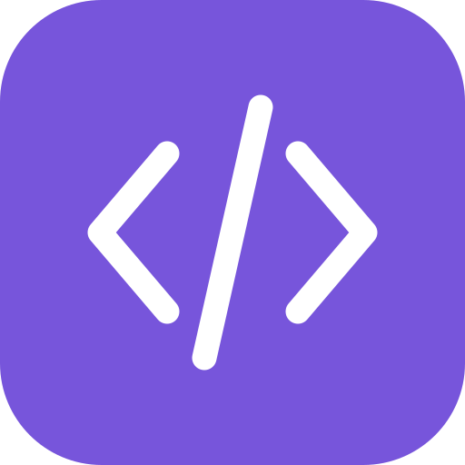

<div align="center">



# Snapcode

**Your code, beautifully framed.** A private, local-first, offline-capable code-to-image studio built with React, TypeScript, and Vite.

[](https://github.com/SudhirDevOps1/snapcode/actions/workflows/ci.yml)
[](https://github.com/SudhirDevOps1/snapcode/actions/workflows/codeql.yml)
[](https://github.com/SudhirDevOps1/snapcode/actions/workflows/release.yml)
[](LICENSE)
[](docs/PWA.md)
[](SECURITY.md)

</div>

Paste a snippet, choose a look, and download a crisp **2x / 3x / 4x PNG** or **vector SVG**. No account, code uploads, analytics, or third-party font requests. Style preferences are saved locally with strict validation; your code stays in the current tab and is never persisted or transmitted.

## Quick Start

Use Node.js **22 LTS** (Node 20.19+ is supported) and npm.

```sh
nvm use
npm ci
npm run dev
```

Open the URL printed by Vite, normally `http://localhost:5173`. No environment variables, API keys, database, or backend are needed.

```sh
npm run build
npm run preview
```

Use the production preview to test offline behavior. Service workers are deliberately disabled in development.

## The Studio

- **Code:** paste, type, import a text file, or load a language example. Language changes preserve custom code.
- **Style:** adjust theme, font, text size, background, padding, shadow, corner radius, line numbers, and window chrome.
- **Export:** lossless PNG at 2x, 3x, or 4x, including transparent backgrounds. Copy an image to the clipboard or prepare it for a native share sheet where supported.
- **Templates:** five curated presets that change styling without touching your code.
- **Live preview:** automatically fits the available space; actual-size and fullscreen views are available.
- **Mobile:** responsive preview, touch-friendly controls, and a persistent export bar.
- **PWA:** installable on supporting browsers. All fonts are bundled, so offline creation and export work after a successful initial production load.

### Languages (28 + Auto-Detect)

JavaScript, TypeScript, Python, Rust, Go, Java, C#, C++, Kotlin, Scala, Elixir, Dart, Swift, HTML, CSS, SQL, GraphQL, JSON, YAML, TOML / INI, Dockerfile, Nginx, Bash, PHP, Ruby, Lua, Markdown, and Diff. Auto-detection is also available; choose explicitly if a short snippet is ambiguous.

### Styling & Advanced Controls

- **Dark & Light Studio Mode:** toggle the entire workspace UI between light and dark modes from the top bar, or flip editor theme polarity with one click.
- **24 Editor Themes (16 Dark & 8 Light, All WCAG AA Contrast-Verified):**
  - _Dark:_ Midnight, Catppuccin Mocha, Dracula, Nord, One Dark Pro, GitHub Dark, Tokyo Night, Night Owl, Gruvbox Dark, Kanagawa Wave, SynthWave '84, Monokai, Vesper, Everforest Dark, Poimandres, Palenight.
  - _Light:_ GitHub Light, Catppuccin Latte, Solarized Light, Rosé Pine Dawn, Gruvbox Light, One Light, Ayu Light, Everforest Light.
- **13 Bundled Monospace Fonts (Zero External Requests):** JetBrains Mono, Fira Code, Cascadia Code, Commit Mono, IBM Plex Mono, Source Code Pro, Victor Mono, Martian Mono, Inconsolata, Anonymous Pro, Space Mono, Roboto Mono, and Ubuntu Mono.
- **Backgrounds & Aspect Ratios:** 16 curated gradients, custom two-color gradient, solid color, transparency, 4 geometric patterns (`Starfield`, `Blueprint`, `Studio Grid`, `Diagonal`), and `Auto fit` / `16:9 Slide` / `2:1 Social Card` / `4:5 Portrait` / `1:1 Square` framing.
- **Line Annotations & Diffs:** focus specific lines (`2, 5-7`), mark `+` added or `-` removed diff lines, dim unfocused lines, set custom starting line numbers, toggle font ligatures, adjust line height, switch window chrome styles (`macOS`, `macOS Outline`, `Windows`, `Terminal`, `None`), frame borders (`Subtle`, `Crisp`, `Glass`, `Neon Glow`), language header badge, **Tidy** code formatter, and validated **Style JSON** copy/import.
- **Multi-Format Export:** lossless **2x / 3x / 4x PNG**, crisp **Vector SVG**, direct **Clipboard PNG copy**, and native **Web Share** sheet support.

### Shortcuts

| Shortcut                    | Action                              |
| --------------------------- | ----------------------------------- |
| Ctrl / Cmd + S              | Download PNG                        |
| Ctrl / Cmd + E              | Focus the code editor               |
| Tab in the editor           | Insert two spaces                   |
| Escape, then Tab            | Leave the editor using the keyboard |
| Escape in a dialog          | Close the dialog                    |
| Left / right arrows on tabs | Switch control tabs                 |

## Development Commands

| Command                | Purpose                                                                                       |
| ---------------------- | --------------------------------------------------------------------------------------------- |
| `npm run dev`          | Development server with hot reload                                                            |
| `npm run icons`        | Generate exact-size PNG icons and downloadable documentation                                  |
| `npm run build`        | Generate icons, bundle, hash production scripts, version the offline cache, and verify assets |
| `npm run preview`      | Serve the production build locally                                                            |
| `npm run typecheck`    | Check application, unit-test, and browser-test types                                          |
| `npm run lint`         | ESLint and React Hooks checks                                                                 |
| `npm run format`       | Format source, configs, and documentation                                                     |
| `npm run format:check` | Check formatting without writing                                                              |
| `npm test`             | Unit tests                                                                                    |
| `npm run test:e2e`     | Production browser tests on desktop and mobile Chromium                                       |
| `npm run test:e2e:ui`  | Interactive Playwright runner                                                                 |
| `npm run check`        | Formatting, typecheck, lint, unit tests, and production build                                 |

Install browser binaries and Linux libraries before the first end-to-end run:

```sh
npx playwright install --with-deps chromium
npm run test:e2e
```

Browser tests validate actual PNG files and pixel transparency, local font export after offline reload, language selection, preference persistence, file rejection, templates, keyboard navigation, responsive overflow, inert HTML input, and automated WCAG AA checks. Automated checks are not a substitute for a manual accessibility review or testing native OS install/share sheets.

## Project Structure

```text
src/
  App.tsx                   Studio orchestration and export actions
  components/               Controls, live canvas, dialogs, branding, recovery UI
  hooks/usePwa.ts            Install capability and offline readiness
  lib/data.ts               Languages, samples, themes, fonts, and presets
  lib/settings.ts           Validated preference persistence
  lib/fonts.ts              Embedded local font sources
  lib/export.ts             Exact-size PNG rendering and memory limits
  lib/files.ts              Safe text-file import
  lib/highlight.ts           Highlight.js grammars and escaped output
e2e/                        Production browser tests
scripts/                    Reproducible icons and build verification
public/                     PWA assets and hosting-header template
docs/                       Architecture, deployment, customization, operations
.github/                    CI, browser tests, CodeQL, releases, dependency updates
```

`public/icon-192.png`, `public/icon-512.png`, and `public/docs/` are generated from tracked source at every build. Missing generated files cannot silently produce a broken PWA: the build checks icon sizes and manifest references.

## Deployment

Deploy **all of `dist/`**, not just `index.html`, over HTTPS at the domain root. Use `npm run build`, not `vite build` directly, so production hardening runs.

| Target                     | Configuration                                                                            |
| -------------------------- | ---------------------------------------------------------------------------------------- |
| Netlify / Cloudflare Pages | Build `npm run build`, publish `dist`; generated `_headers` contains the script-hash CSP |
| Vercel                     | Included `vercel.json`; generated HTML enforces script hashes through its CSP meta tag   |
| Docker                     | Non-root nginx on port 8080, with generated CSP headers and `/healthz`                   |
| Other static servers       | Copy `dist/` and apply equivalent response headers                                       |

```sh
docker build -t snapcode:local .
docker run --rm -p 8080:8080 snapcode:local
```

The Docker and GitHub workflow configurations need their first successful run in your hosting environment before a production launch. See [deployment](docs/DEPLOYMENT.md) and the [release checklist](docs/OPERATIONS.md).

## Quality and Release Workflow

- **CI ([`ci.yml`](.github/workflows/ci.yml)):** formatting, strict types, lint, unit tests, and builds on Node 22 and 24; separate browser, production dependency-audit, and container smoke-test jobs.
- **CodeQL ([`codeql.yml`](.github/workflows/codeql.yml)):** JavaScript/TypeScript static security and quality analysis on changes and weekly schedules.
- **GitHub Pages ([`pages.yml`](.github/workflows/pages.yml)):** automated static deployment workflow on pushes to `main` (enable Pages → GitHub Actions in repository settings).
- **Dependabot ([`dependabot.yml`](.github/dependabot.yml)):** scheduled npm, GitHub Actions, and Docker update proposals. Review and test before merging.
- **Release ([`release.yml`](.github/workflows/release.yml)):** a version tag must match `package.json`. Checks and browser tests run before publishing a build ZIP, CycloneDX SBOM, and SHA-256 checksums.

Push a release only after reviewing the changelog and configuring repository protections:

```sh
npm version patch
git push --follow-tags
```

## Boundaries

- Files must be no larger than 1 MB and contain at most 100,000 characters. Oversized files are rejected, never silently truncated.
- Output is limited to 16,384 pixels per side and 32 megapixels total. Reduce resolution or snippet size if an image exceeds the limit.
- Latin font subsets are bundled. Other scripts use the browser's fallback fonts; exported glyph coverage depends on the device.
- Clipboard, fullscreen, native sharing, and installation vary by browser and permissions. Download is the primary sharing path.
- No certification, compliance guarantee, enterprise SLA, SSO, or server-side collaboration is implied. This is a hardened static application, not an enterprise account platform.

## Documentation

[Architecture](docs/ARCHITECTURE.md) | [Deployment](docs/DEPLOYMENT.md) | [Customization](docs/CUSTOMIZATION.md) | [Offline/PWA](docs/PWA.md) | [Operations](docs/OPERATIONS.md) | [Security](SECURITY.md) | [Contributing](CONTRIBUTING.md) | [Changelog](CHANGELOG.md)

## License

[MIT](LICENSE). Third-party packages and fonts retain their own licenses; see [THIRD_PARTY_NOTICES.md](THIRD_PARTY_NOTICES.md).
